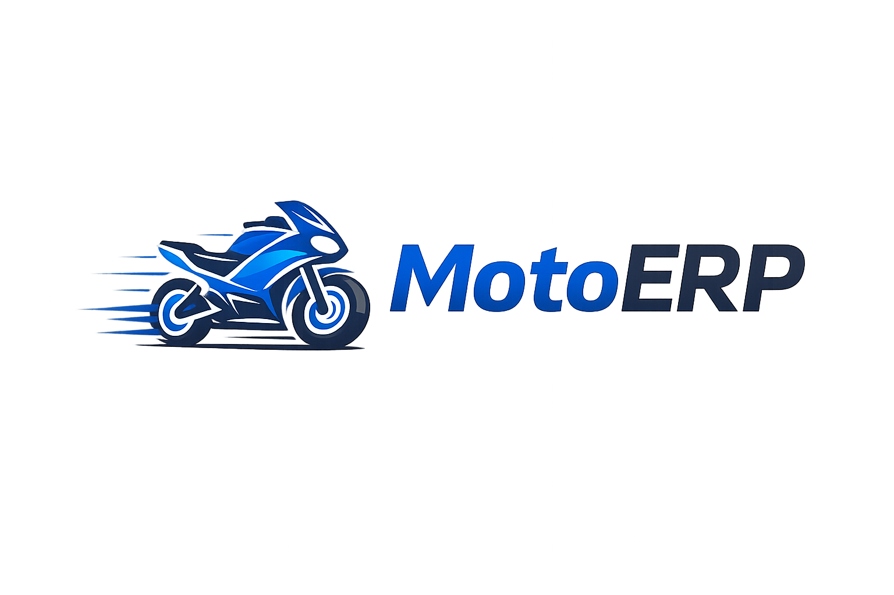
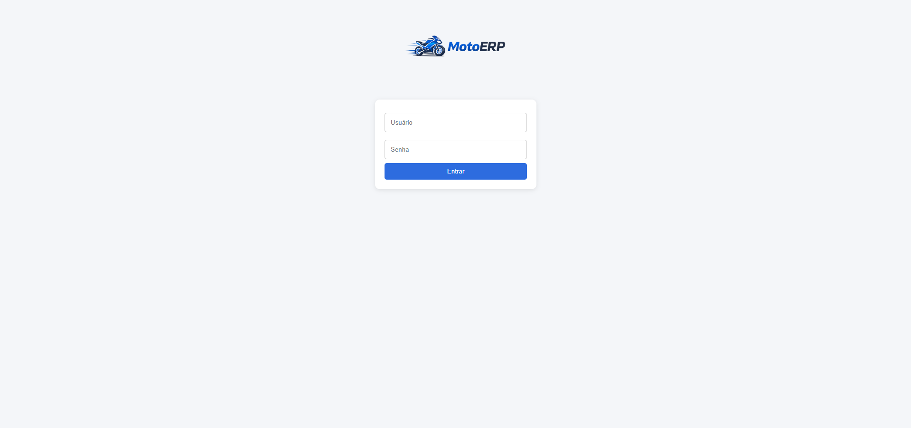
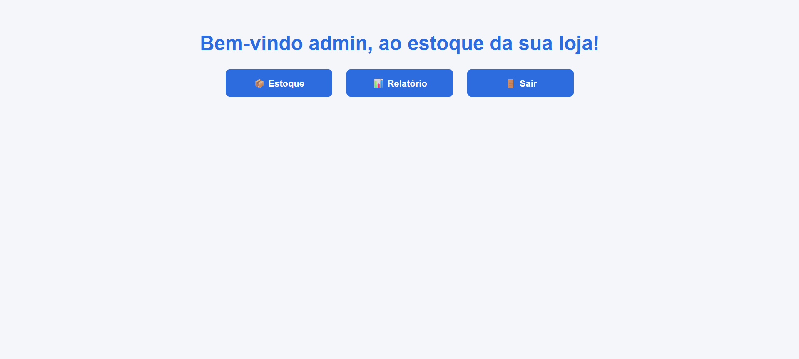
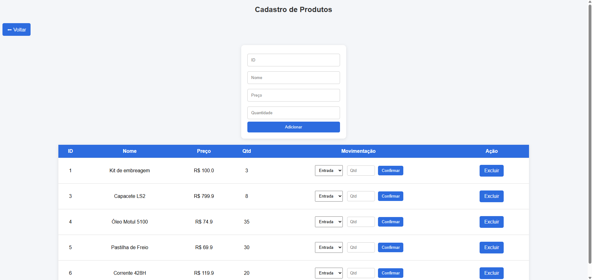
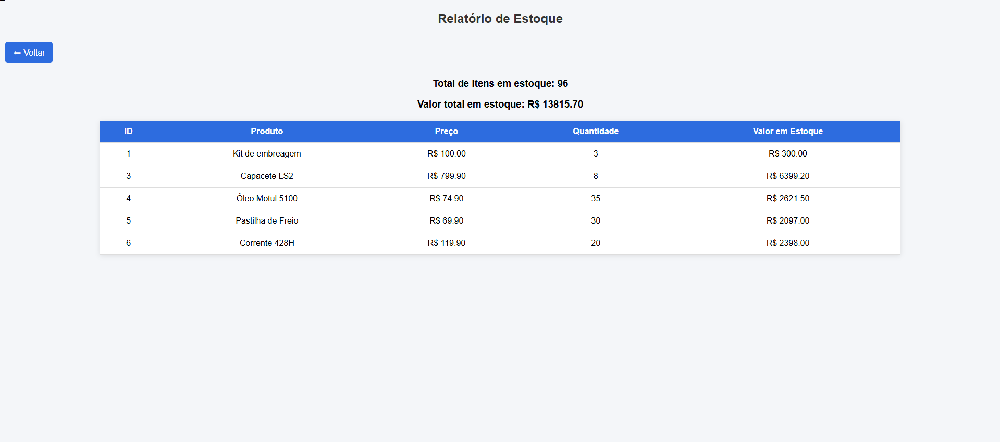

<div align="center">



#  MotoERP

### Sistema ERP para gerenciamento de estoque de peças e produtos para motocicletas.


</div>

---

#  Sobre

O **MotoERP** é um sistema de gerenciamento de estoque desenvolvido em **Python** utilizando **Flask**.

O projeto foi criado com o objetivo de simular um sistema ERP utilizado em lojas de peças para motocicletas, permitindo o cadastro de produtos, movimentação de estoque e geração de relatórios.

Além de reforçar conhecimentos em desenvolvimento web, este projeto permitiu aplicar conceitos de:

- Programação Orientada a Objetos
- CRUD
- Banco de Dados
- Flask
- SQLite
- HTML
- CSS

---

#  Funcionalidades

- 🔐 Login de usuários
- 📦 Cadastro de produtos
- ➕ Entrada de estoque
- ➖ Saída de estoque
- 📊 Relatório de estoque
- 💰 Cálculo automático do valor total do estoque
- 🗑️ Exclusão de produtos
- 💾 Banco de dados SQLite

---

#  Tecnologias

- Python
- Flask
- SQLite
- HTML5
- CSS3

---

#  Estrutura

```
MotoERP
│
├── static/
│   ├── logo.png
│   └── style.css
│
├── templates/
│   ├── login.html
│   ├── home.html
│   ├── produtos.html
│   └── relatorio_estoque.html
│
├── app.py
├── database.py
├── produto.py
├── usuario.py
├── README.md
└── requirements.txt
```

---

#  Como executar

Clone o projeto

```bash
git clone https://github.com/SEU-USUARIO/MotoERP.git
```

Entre na pasta

```bash
cd MotoERP
```

Instale as dependências

```bash
pip install flask
```

Execute

```bash
python app.py
```

A aplicação ficará disponível em:

```
http://127.0.0.1:5000
```

---

# 📸 Demonstração

## Login



---

## Tela Inicial



---

## Cadastro de Produtos



---

## Relatório



---

#  Objetivo

Este projeto foi desenvolvido para colocar em prática conhecimentos adquiridos durante a graduação em Engenharia da Computação, explorando o desenvolvimento de aplicações web com Python e Flask.

---

#  Melhorias Futuras

- Editar produtos
- Pesquisa de produtos
- Dashboard com gráficos
- Exportação para PDF
- Controle de permissões
- Cadastro de usuários
- Banco de dados MySQL/PostgreSQL
- Deploy na nuvem

---

#  Autor

### Anthony Lima

Estudante de Engenharia da Computação

- GitHub: https://github.com/Anthony-Lima-Oliveira
- LinkedIn: https://linkedin.com/in/anthony-lima-de-oliveira-3312a1300/

---

<div align="center">

###  Se gostou do projeto, deixe uma estrela no repositório!

</div>